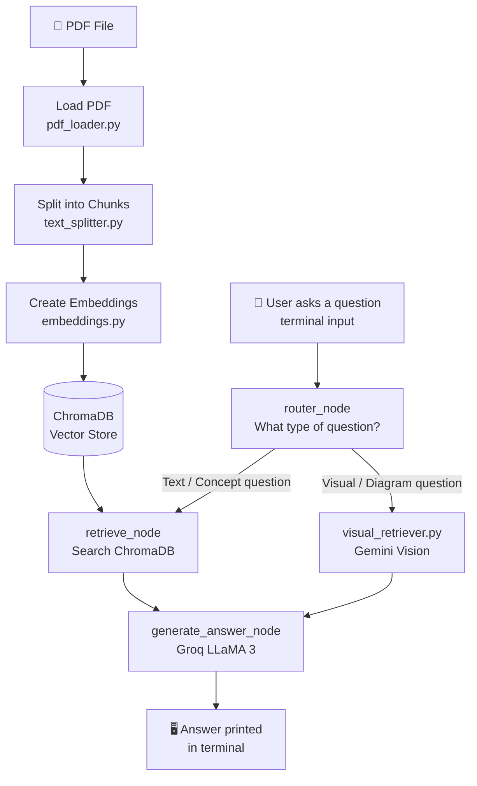

# 🧠 VIDYA — The AI Knowledge Person

> *"What if your study notes could talk back to you?"*

An AI-powered terminal tutor that reads your PDF and answers your questions — using both text understanding and actual page vision.

---

## 💡 The Thinking — Why I Built This

As a student, I had this problem:

- PDFs are long and boring to search through manually
- Google gives general answers — not answers **from my specific notes**
- Diagrams and figures in PDFs are completely ignored by normal chatbots

So I thought:

> **"What if I could just ask my PDF a question and it would answer from inside the PDF itself?"**

That became **VIDYA**.

---

## 🗺️ My Thinking Flow (How the Idea Evolved)

```
Student Problem
     |
     v
"My PDF has the answer but I can't find it fast"
     |
     v
Idea: Build a chatbot that reads MY PDF
     |
     v
First try: Simple RAG (text only)
     |
     |--- Problem: Can't understand diagrams/images in PDF
     |
     v
Second try: Add LangGraph for pipeline control
     |
     |--- Problem: No routing — everything went through same path
     |
     v
Third try (V3): Smart router + Gemini Vision for images
     |
     v
VIDYA — Working terminal tutor ✅
```

---

## 🏗️ System Architecture



---

## ⚙️ Pipeline — Step by Step

| Step | File | What Happens |
|------|------|-------------|
| 1 | `pdf_loader.py` | Reads the PDF from disk |
| 2 | `text_splitter.py` | Breaks text into small overlapping chunks |
| 3 | `embeddings.py` | Converts chunks to vector numbers |
| 4 | `vector_store.py` | Saves vectors into ChromaDB |
| 5 | `nodes.py` → `router_node` | Reads your question, decides: text or vision? |
| 6 | `nodes.py` → `retrieve_node` | Finds the most relevant chunks from ChromaDB |
| 7 | `vision/visual_retriever.py` | If visual question → sends PDF page image to Gemini |
| 8 | `nodes.py` → `generate_answer_node` | Groq LLaMA 3 generates final answer |
| 9 | `main.py` | Prints answer to terminal |

All steps are connected via **LangGraph** (`graph.py`) as a state machine.

---

## 🔥 Problems We Faced & How We Solved Them

### ❌ Problem 1: Google Gemini API kept crashing (429 error)
Gemini free tier only allows **5 requests per minute**.  
Every visual question hit the limit and crashed the app.

**✅ Fix:** Built **Smart Intent Routing** — only questions about diagrams/images/figures go to Gemini. Text questions use Groq (fast, unlimited). Also added **exponential backoff retry** — if Gemini is busy, wait and retry automatically.

---

### ❌ Problem 2: Windows terminal was crashing with encoding errors
Code had `→` arrows in print statements.  
Windows terminal uses `cp1252` encoding which doesn't support Unicode arrows.

**✅ Fix:** Replaced all `→` with ASCII `->`. Simple but took time to find!

---

### ❌ Problem 3: `google.generativeai` was deprecated
We were using the old SDK. It started throwing import errors and was officially deprecated.

**✅ Fix:** Migrated entire vision module to the new `google-genai` SDK with updated API calls.

---

### ❌ Problem 4: No way to control the pipeline flow
Early version was just sequential function calls — hard to debug and extend.

**✅ Fix:** Rebuilt the entire pipeline using **LangGraph StateGraph** — each step is a node, flow is a graph. Easy to add/remove steps.

---

### ❌ Problem 5: Git not in Windows PATH
`git init` kept failing even though Git was installed.

**✅ Fix:** Used full path `C:\Program Files\Git\bin\git.exe` directly in PowerShell.

---

## 🛠️ Tech Stack

| Tool | Purpose |
|------|---------|
| **LangGraph** | Pipeline as a state graph |
| **ChromaDB** | Store and search text vectors (RAG) |
| **Groq + LLaMA 3** | Fast text question answering |
| **Gemini Vision** | Understand PDF page images |
| **PyMuPDF (fitz)** | Convert PDF pages to images |
| **sentence-transformers** | Create text embeddings |
| **python-dotenv** | Manage API keys safely |

---

## 🚀 How to Run

```bash
# 1. Install dependencies
pip install -r requirements.txt

# 2. Set up your API keys in .env file
# GROQ_API_KEY=your_key
# GEMINI_API_KEY=your_key

# 3. Run VIDYA
python -m app.main
```

Then just type your question. Type `exit` to quit.

---

## 📁 Project Structure

```
ai-tutor/
├── app/
│   ├── main.py              # Entry point — terminal chat loop
│   ├── graph.py             # LangGraph pipeline definition
│   ├── graph_state.py       # Shared state between nodes
│   ├── nodes.py             # All pipeline nodes (router, retrieve, answer)
│   ├── embeddings.py        # Embedding model setup
│   ├── vector_store.py      # ChromaDB setup
│   ├── pdf_loader.py        # PDF reading
│   ├── text_splitter.py     # Chunk splitting
│   ├── llm.py               # LLM setup (Groq + Gemini)
│   └── vision/
│       ├── pdf_renderer.py      # PDF page → image
│       └── visual_retriever.py  # Gemini Vision calls
├── data/                    # Your PDF files go here
├── docs/                    # Architecture docs
├── requirements.txt
├── .env                     # API keys (not in GitHub)
└── README.md
```

---

## 👤 Built By

**Aditya Pawar** — Learning AI engineering by building real projects, not just tutorials.

> This project taught me: RAG, LangGraph, Vision AI, API rate limiting, Windows encoding bugs, and how to push code to GitHub even when `git` isn't in PATH. 😄
