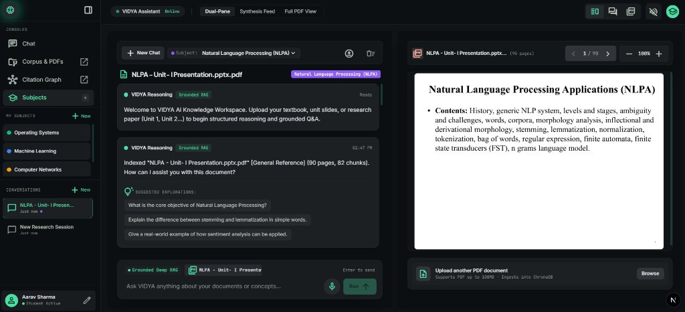
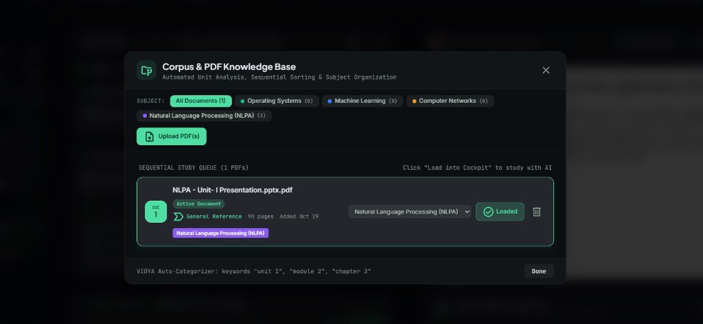
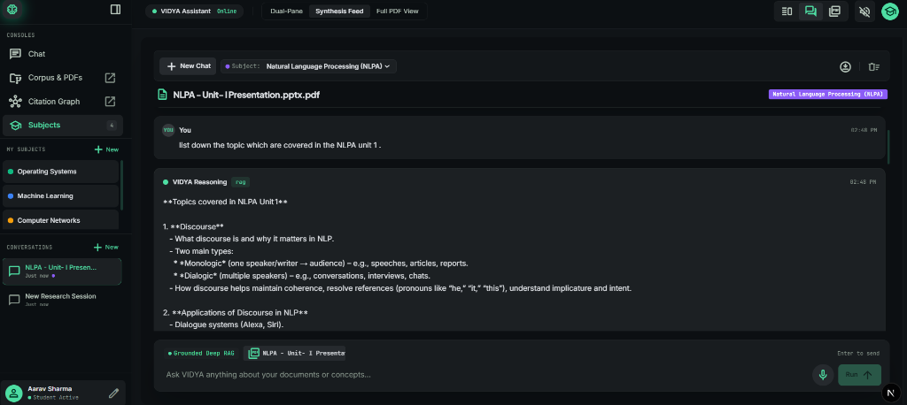
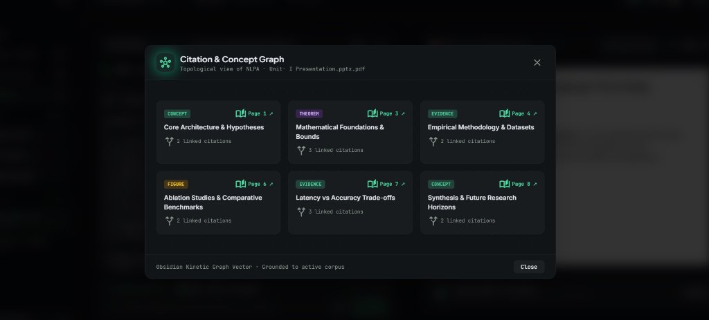

# 🧠 VIDYA — The AI Knowledge Person
### *Frontend UI · Obsidian Kinetic Design System*

> *"What if your study notes could talk back to you?"*

An AI-powered **knowledge workspace** with a stunning dark-mode interface — built for students and researchers who want to study smarter, not harder. Upload your PDFs, ask questions, and get grounded, cited answers from your own documents.

---

## ✨ Screenshots

### 🖥️ Main Chat — Dual-Pane Knowledge Workspace
> Ask VIDYA anything about your documents. The right pane renders the actual PDF page side-by-side with the AI's answer.



---

### 📂 Corpus & PDF Knowledge Base Manager
> Upload, organize and manage your PDFs by subject. VIDYA auto-categorizes documents by unit/chapter keywords.



---

### 🔬 Synthesis Feed — Deep Reasoning View
> Switch to Synthesis Feed mode to get structured, detailed breakdowns of complex topics from your documents.



---

### 🕸️ Citation & Concept Graph
> Visual topological map of concepts, theorems, and evidence extracted from your PDF — each card links back to the exact page.



---

## 💡 Why I Built This

As a student, I had this problem:
- PDFs are long and boring to search through manually
- Google gives general answers — not answers **from my specific notes**
- Diagrams and figures in PDFs are completely ignored by normal chatbots

So I thought:
> **"What if I could just ask my PDF a question and it would answer from inside the PDF itself?"**

That became **VIDYA** — and this repo is the frontend that makes it beautiful.

---

## 🎨 Design System — Obsidian Kinetic

The UI is built around a custom design philosophy called **"Obsidian Kinetic / Space Green Cybernetic"**:

- 🌑 **Dense obsidian carbon surfaces** (`#090d10` → `#101417`) — zero eye fatigue for long study sessions
- 💚 **Electric emerald telemetry accents** (`#10b981`, `#4edea3`) — clear visual hierarchy
- 🔭 **Tactile glassmorphism** — multi-layered frosted panels with `1px` micro-borders
- 🖋️ **3-font optical triage**: Plus Jakarta Sans (headlines) · Inter (body) · JetBrains Mono (citations/metadata)

---

## 🏗️ Frontend Architecture

```
vidya-frontend/
├── src/
│   └── app/
│       ├── page.tsx                    # Main workspace layout
│       ├── layout.tsx                  # Root layout + fonts
│       ├── globals.css                 # Tailwind + CSS variables
│       ├── components/
│       │   ├── Header.tsx              # Top nav bar (view switcher)
│       │   ├── Sidebar.tsx             # Left nav (Consoles, Subjects, Conversations)
│       │   ├── LeftSynthesisPane.tsx   # AI chat + reasoning pane
│       │   ├── RightDocumentPane.tsx   # Live PDF viewer pane
│       │   ├── CorpusManagerModal.tsx  # PDF upload & management modal
│       │   ├── CitationGraphModal.tsx  # Concept graph modal
│       │   └── NeuralBackground.tsx    # Animated canvas background
│       └── utils/
│           ├── corpusUtils.ts          # PDF corpus state management
│           └── subjectDetection.ts     # Auto subject categorization
├── public/
│   └── screenshots/                   # UI screenshots
├── package.json
└── next.config.ts
```

---

## 🛠️ Tech Stack

| Tool | Purpose |
|------|---------|
| **Next.js 16** | React framework with App Router |
| **React 19** | Latest React with concurrent features |
| **Tailwind CSS v4** | Utility-first styling |
| **TypeScript** | Type-safe codebase |
| **Lucide React** | Clean icon library |
| **Canvas Confetti** | Celebratory micro-interactions |
| **clsx + tailwind-merge** | Dynamic class composition |

---

## 🚀 How to Run

```bash
# 1. Clone the repo
git clone https://github.com/Aditya-Pawar30/VIDYA-The-AI-Knowledge-Person.git
cd VIDYA-The-AI-Knowledge-Person

# 2. Switch to the frontend branch
git checkout frontend

# 3. Install dependencies
npm install

# 4. Start the dev server
npm run dev
```

Open [http://localhost:3000](http://localhost:3000) in your browser.

> **Note:** The frontend connects to the VIDYA Python backend (`ai-tutor/`). Make sure the backend is running on `http://localhost:8000` for full functionality.

---

## 🔗 Related

- **Backend (Python + LangGraph)** → [`main` branch](https://github.com/Aditya-Pawar30/VIDYA-The-AI-Knowledge-Person/tree/main)
- **Architecture Docs** → [`docs/`](https://github.com/Aditya-Pawar30/VIDYA-The-AI-Knowledge-Person/tree/main/docs)

---

## 👤 Built By

**Aditya Pawar** — Learning AI engineering by building real projects, not just tutorials.

> This project taught me: RAG, LangGraph, Vision AI, LangGraph state machines, Next.js App Router, Tailwind v4, and how to design a UI system from scratch. 🚀
